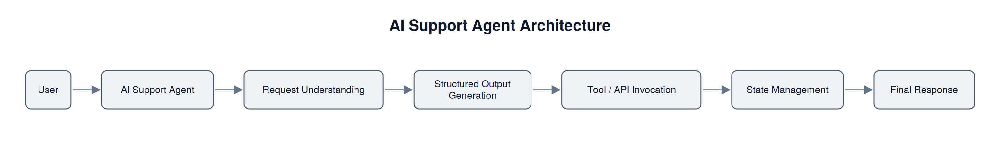

# AI Support Agent

An AI customer support chatbot built with Amazon Bedrock AgentCore, demonstrating agent orchestration, tool calling, state management, and multi-step customer interactions.

## Overview

This project demonstrates how to build an AI support agent using Amazon Bedrock AgentCore and the Strands Agents SDK. The agent is designed to interpret user requests, generate structured outputs, invoke tools or APIs when needed, maintain interaction state, and return a final response.

Unlike a simple prompt workflow, this project focuses on agent behavior, where the system can coordinate multiple steps and external actions as part of the response process.

## Architecture and Workflow

The architecture follows an agent-based workflow:

- **User**: The workflow starts when a user submits a support request.
- **AI Support Agent**: The central agent receives the request and coordinates the response process.
- **Request Understanding**: The agent interprets the user’s message to determine the task and required action.
- **Structured Output Generation**: The agent organizes its reasoning and response format into a structured output for more reliable downstream handling.
- **Tool / API Invocation**: When needed, the agent calls external tools or APIs to retrieve information or perform actions.
- **State Management**: The workflow maintains relevant context across interactions so the agent can respond consistently.
- **Final Response**: The completed response is returned to the user.

## My Contributions

In this project, I:
- Built the core agent workflow for handling support requests
- Designed structured output handling to improve response consistency
- Integrated tool-based actions where needed in the workflow
- Incorporated state management for multi-step interactions
- Tested and refined the agent’s behavior across different request types
- Documented implementation choices and tradeoffs

## Key Findings

This project deepened my understanding of agent orchestration, structured outputs, tool integration, and state-aware interactions. It also highlighted the importance of designing agents that can reliably combine reasoning, external actions, and conversational continuity.
